# ClipFlow Pro

[](https://github.com/nickotmazgin/clipflow-pro/releases/latest)
[](https://github.com/nickotmazgin/clipflow-pro/actions)
[](https://github.com/nickotmazgin/clipflow-pro/releases)
[](LICENSE)
[](#compatibility)
[](#compatibility)
[](#compatibility)
[](#compatibility)

[](https://github.com/nickotmazgin/clipflow-pro/issues)
[](https://github.com/nickotmazgin/clipflow-pro/discussions)
[](https://github.com/nickotmazgin/clipflow-pro/stargazers)

> If ClipFlow Pro saves you time, a ⭐ on GitHub helps other GNOME users find it.

**ClipFlow Pro** is a clipboard history manager for **GNOME Shell 45–51** on **Wayland and X11/Xorg** sessions (UUID `clipflow-pro@nickotmazgin.github.io`).

> **Latest: v1.5.8** — the right-click recent clips menu is readable on light shell themes; v1.5.7 added password-manager support. **Previous releases are kept for history**; download only from [Releases](https://github.com/nickotmazgin/clipflow-pro/releases/latest).

> **GNOME Shell 43–44 is no longer supported.** ClipFlow Pro now targets **GNOME 45–51 only**. Upgrade your desktop environment to GNOME **45** or newer.

> **Keywords:** GNOME clipboard manager · Linux clipboard history · Wayland · X11 · Xorg · history window · copy paste · productivity · privacy · open source

---

## Demo video

*A 2-minute narrated tour of ClipFlow Pro ([also on YouTube](https://youtu.be/Cao9ljjI5JI); turn the sound on; [announcement](https://github.com/nickotmazgin/clipflow-pro/discussions/170)): copying text, a link, code, JSON, numbers, symbols, emoji and several languages (including right-to-left); the right-click recent clips menu; the panel menu with the ⋮ clip menu and Actions; instant search in the history window; and every settings tab.*

https://github.com/user-attachments/assets/7620ff29-6f1b-4ad2-a2e1-fe57f8f2e120

---

## Screenshots

### Main collage

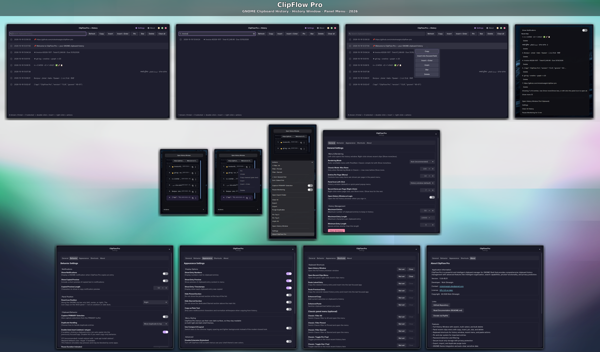

### v1.5.8 gallery

**History window**

| History window | Search | Row actions (right-click) |
|:---:|:---:|:---:|
| 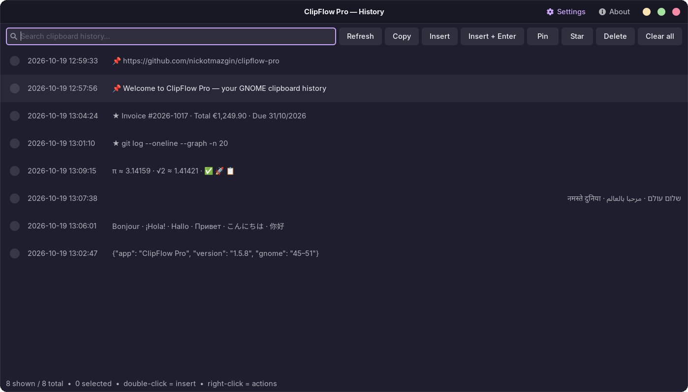 | 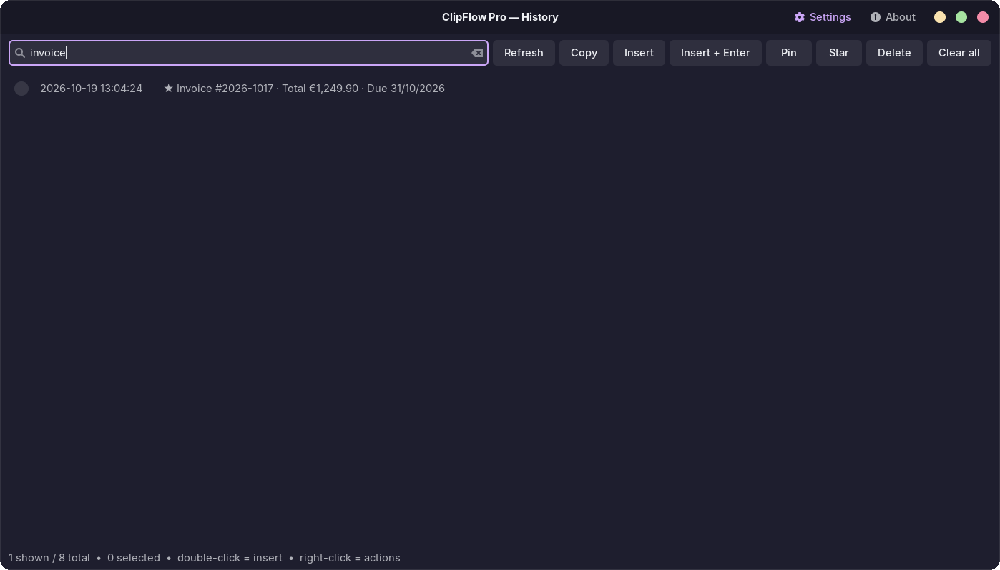 | 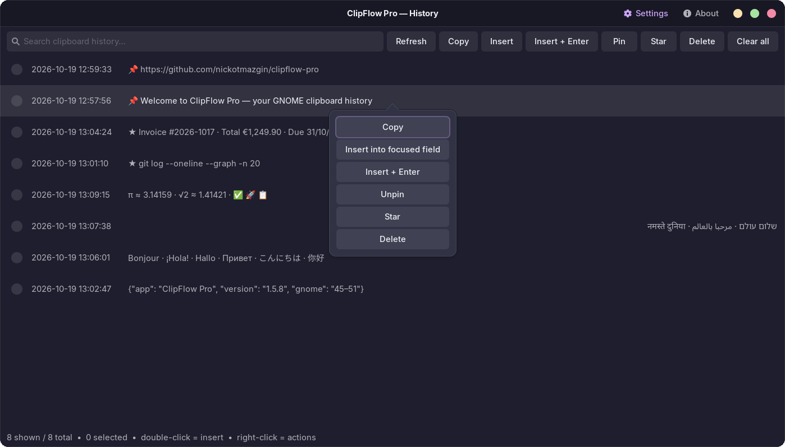 |

**Panel icon menus**

| Recent clips (right-click) | Panel menu | ⋮ clip menu | Actions |
|:---:|:---:|:---:|:---:|
| 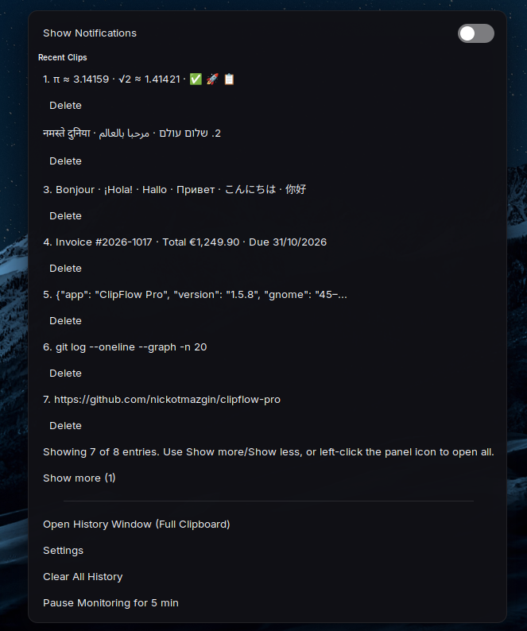 | 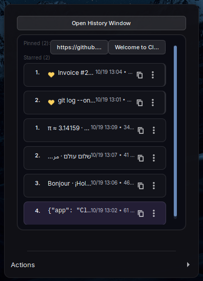 | 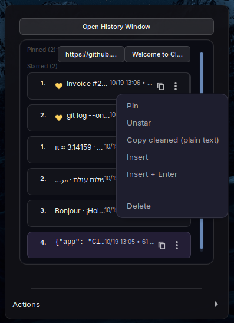 | 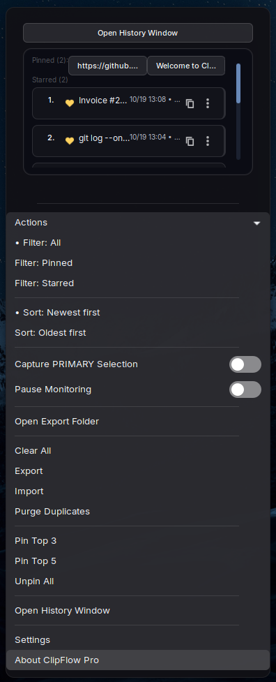 |

**Settings**

| General | Behavior | Appearance | Shortcuts | About |
|:---:|:---:|:---:|:---:|:---:|
| 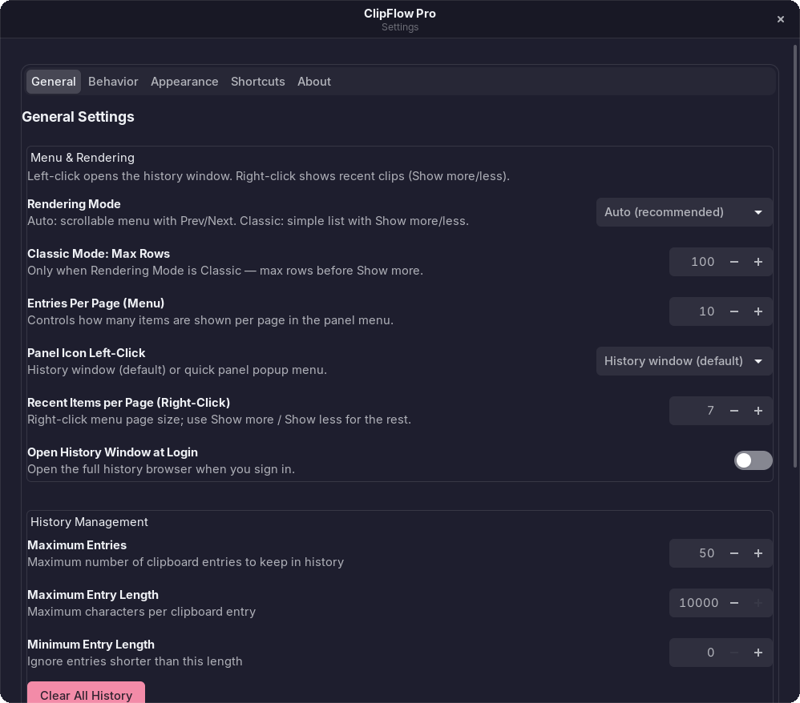 | 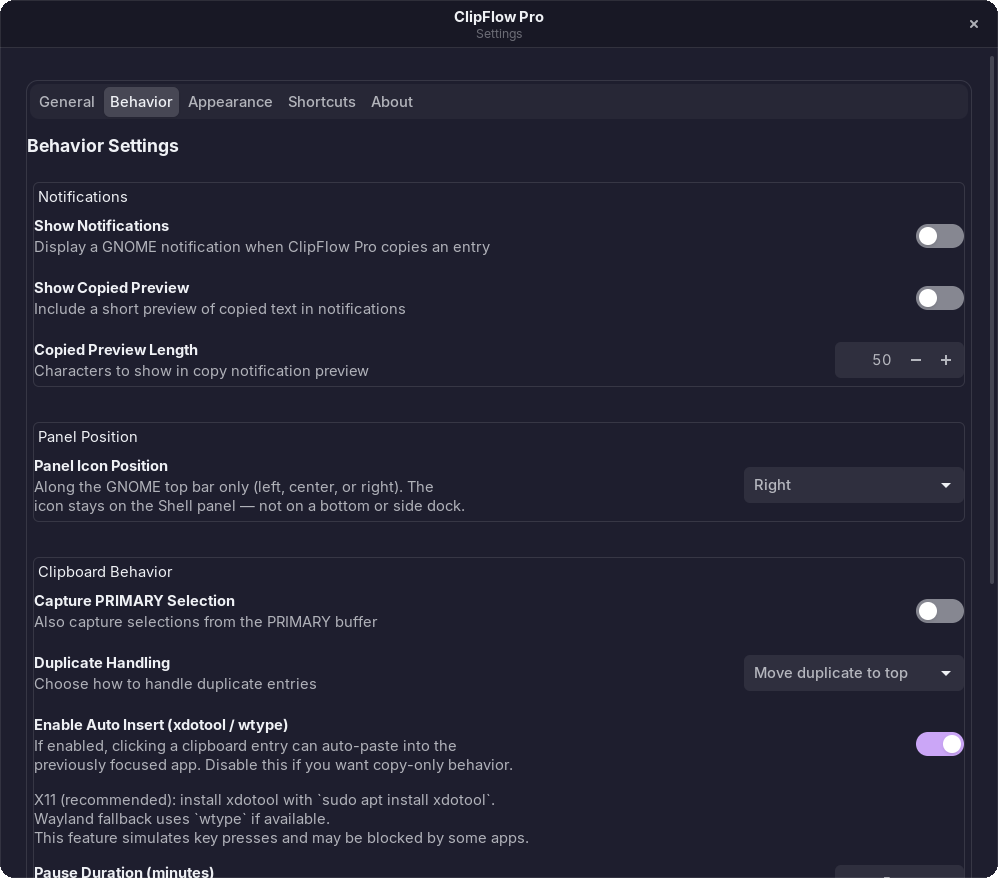 | 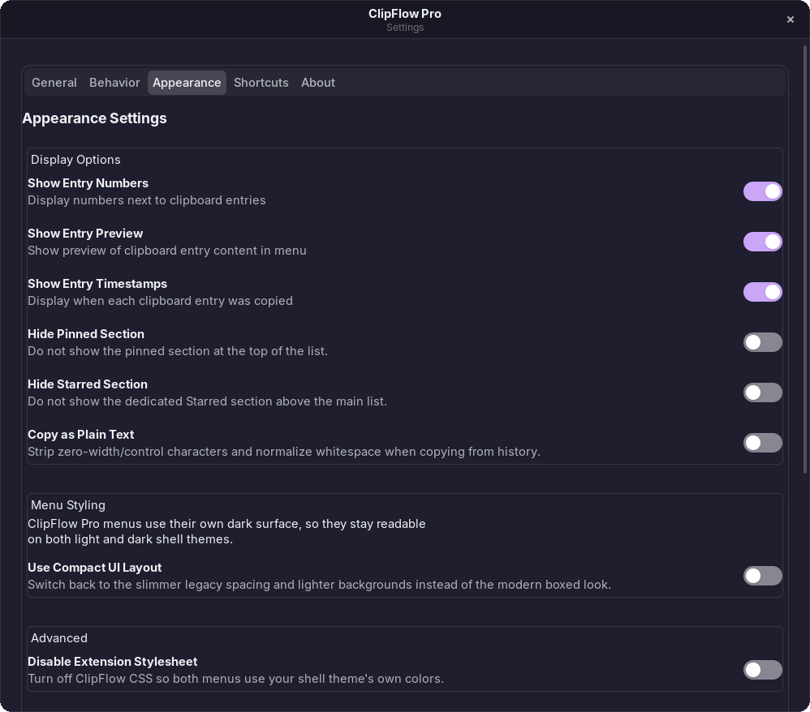 | 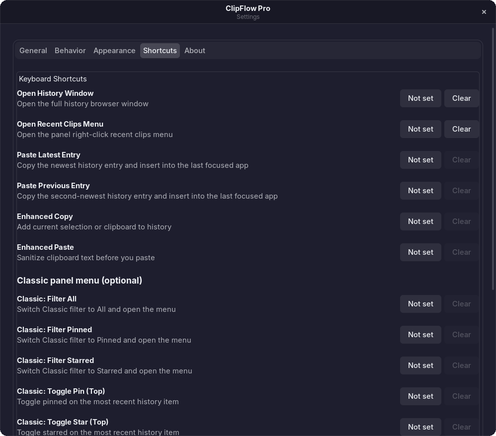 | 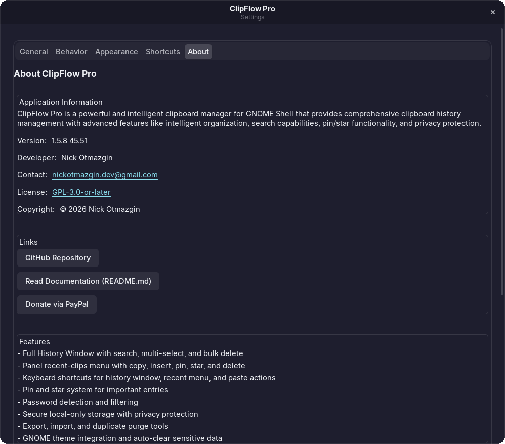 |

Full combined image (download): [collage-v1.5.8.png](screenshots/collage-v1.5.8.png) · Screenshots and the demo video are made with [`tools/media`](tools/media/README.md).

---

## What's new in v1.5.8

- **Readable on light themes:** the right-click recent clips menu now has the same dark surface as the panel menu, so it stays readable when your shell theme is light (it showed white text on a light background before). Tested with Zorin's light and Catppuccin dark shell themes
- **"Disable Extension Stylesheet" works for both menus:** turning it on now hands both menus back to your shell theme's own colors

### v1.5.7

- **Respects password managers:** when KeePassXC or another password manager marks a copied password as secret, ClipFlow Pro doesn't save it (Settings → *Ignore Password-like Content*, on by default). This also covers the copy GNOME keeps after the password manager closes. Tested with KeePassXC 2.7.6
- Older release notes: see the table below and [CHANGELOG.md](CHANGELOG.md)

## Recent releases

Recent tagged releases on [GitHub](https://github.com/nickotmazgin/clipflow-pro/releases) (GNOME 45+):

| Version | Highlights |
|---------|------------|
| **1.5.8** | Recent clips menu readable on light shell themes |
| **1.5.7** | Respects the password-manager "secret" clipboard hint |
| **1.5.6** | No default clipboard shortcuts, clearer clipboard notice |
| **1.5.5** | GNOME Shell 51 support |
| **1.5.4** | Panel popup menu fix on GNOME 45–47, new gallery and demo video |
| **1.5.3** | Privacy hardening (stdin IPC, 0600 files), safer import, dead-code cleanup |
| **1.5.2** | Lifecycle cleanup, private insert payloads, documentation & privacy hardening |
| **1.5.1** | X11 CPU fix — native `St.Clipboard` first; no `xclip` subprocess on every poll |
| **1.5.0** | Reliable auto-insert, screenshot-safe capture, privacy defaults, Insert menu actions |
| **1.4.9** | Safe disable/upgrade — no `this._clipboard is null` race during in-flight reads |
| **1.4.7** | Faster paste, backlog-free monitoring, bounded recovery, Zorin/X11 UTF-8 fallback |
| **1.4.6** | Clipboard/insert helpers off the Shell thread; terminal-aware paste |

<details>
<summary><strong>Full changelog & older release notes</strong></summary>

Version-by-version notes (including withdrawn **1.4.8** and pre-1.4.3 history) live in **[CHANGELOG.md](CHANGELOG.md)**.

Highlights from earlier milestones:

- **1.4.2** — History Window Settings/About header, multi-select delete, panel Delete row, shortcut additions
- **1.4.1** — History Window (left-click panel icon, Super+Shift+H), enhanced menu rendering, GNOME 46 settings layout

</details>

---

## Compatibility

| GNOME | Status | Notes |
|-------|--------|-------|
| **45–51** | **Supported** | History Window, ESM, enhanced panel menu — use `*-gs45-51.zip`. GNOME 51 is checked against the official porting guide; reports welcome |
| **43–44** | **Discontinued** | No longer built, distributed, or maintained |

| Session | Status | Notes |
|---------|--------|-------|
| **X11 / Xorg** | **Supported · validated** | **v1.5.8** runtime-tested on Zorin OS 18.1 / GNOME Shell 46 / X11 with light and dark shell themes (password-manager hint tested with KeePassXC 2.7.6 on 1.5.7); native `St.Clipboard` first; `Alt+F2` → `r` after install |
| **Wayland** | **Supported** | Code paths + install docs; not maintainer runtime-tested on v1.5.8 — reports welcome |

**Minimum requirement:** GNOME Shell **45** or newer on a **Wayland or X11/Xorg** session.

> **Validation scope (v1.5.8):** maintainer confidence is highest on **X11/Xorg** (local Zorin setup). **Wayland** is supported by design and community use; older release notes were not retroactively re-labeled.

- Panel icon position: **left / center / right** on the GNOME **top bar** (not bottom/side docks)
- Distribution: **GitHub Releases only** (no extensions.gnome.org)

---

## Install

### From GitHub (recommended)

1. Download **`clipflow-pro@nickotmazgin.github.io-*-gs45-51.zip`** from **[Releases](https://github.com/nickotmazgin/clipflow-pro/releases/latest)** (GNOME 45–51 only).
2. Install:

```bash
gnome-extensions install --force clipflow-pro@nickotmazgin.github.io-1.5.8-gs45-51.zip
gnome-extensions enable clipflow-pro@nickotmazgin.github.io
# Wayland: log out/in · X11 only: Alt+F2 → r → Enter
```

### Local build

```bash
./build.sh && ./install.sh
# Wayland: log out/in · X11 only: Alt+F2 → r → Enter
```

---

## Quick Start

1. Copy something — it appears in history
2. **Left-click** panel icon → **History Window**
3. **Right-click** panel icon → recent clips + shortcuts
4. **Settings** → General → **Menu & Rendering** (Auto recommended)

### Features

- Pinned / Starred sections, content-type detection
- Export / Import, purge duplicates, password filtering (respects the password-manager hint KeePassXC and others put on the clipboard, plus keyword/token detection)
- Pause monitoring, clear on lock/logout
- Keyboard shortcuts (Settings → Shortcuts)

### Keyboard shortcuts

No shortcuts are set out of the box (extensions.gnome.org rules don't allow default shortcuts that touch clipboard data). Add the ones you want in **Settings → Shortcuts**: click the button and press your keys. The left column suggests a combination for each.

| Action | Suggested shortcut |
|---|---|
| Open the history window | <kbd>Super</kbd>+<kbd>Shift</kbd>+<kbd>H</kbd> |
| Open the recent clips menu | <kbd>Super</kbd>+<kbd>Shift</kbd>+<kbd>R</kbd> |
| Paste latest entry into the focused app | <kbd>Super</kbd>+<kbd>Shift</kbd>+<kbd>Insert</kbd> |
| Paste the entry before it | <kbd>Super</kbd>+<kbd>Shift</kbd>+<kbd>V</kbd> |
| Enhanced copy (add the selection or clipboard to history) | <kbd>Super</kbd>+<kbd>Shift</kbd>+<kbd>C</kbd> |
| Enhanced paste (clean the text, then paste) | your choice |
| Classic menu: filter all / pinned / starred, toggle pin / star on the top entry | your choice |

In the history window: **double-click** an entry to insert it, **right-click** for copy, insert, pin, star and delete, and type in the search box to filter. In the panel menu, **Enter** or **Space** copies the highlighted clip.

---

## Links

- **Releases:** https://github.com/nickotmazgin/clipflow-pro/releases
- **Issues:** https://github.com/nickotmazgin/clipflow-pro/issues
- **Changelog:** [CHANGELOG.md](CHANGELOG.md)
- **Demo video:** https://youtu.be/Cao9ljjI5JI
- **AlternativeTo:** https://alternativeto.net/software/clipflow-pro/about/
- **Article on DEV:** [ClipFlow Pro 1.5.6: a free, open-source clipboard history manager for GNOME](https://dev.to/nickotmazgin/clipflow-pro-156-a-free-open-source-clipboard-history-manager-for-gnome-45-51-wayland-x11-2o0l)

## More GNOME extensions by Nick Otmazgin

- [Numeric Clock](https://github.com/nickotmazgin/Linux-Numeric-Date-And-Clock) — DD/MM/YYYY 24-hour top-bar clock with seconds
- [Comfort Control (EaseHub)](https://github.com/nickotmazgin/comfort-control-easehub) — panel menu for power, screenshots, updates & utilities

---

## Credits & Acknowledgements

ClipFlow Pro is created, maintained, signed, and released by **[Nick Otmazgin](https://github.com/nickotmazgin)** — the project's sole administrator and solo developer, who authors and reviews all code that ships.

[](https://openai.com/codex/)
[](https://cursor.com)
[](https://claude.com/claude-code)

<table>
  <tbody>
    <tr>
      <td align="center" valign="top" width="25%">
        <a href="https://github.com/nickotmazgin">
          
          <br />
          <sub><b>Nick Otmazgin</b></sub>
        </a>
        <br />
        <sub>Creator &amp; Solo Maintainer</sub>
        <br />
        <sub>💻 🎨 📦 🚀 📖</sub>
      </td>
      <td align="center" valign="top" width="25%">
        <a href="https://github.com/cursoragent">
          
          <br />
          <sub><b>Cursor Agent</b></sub>
        </a>
        <br />
        <sub>AI Pair-Programming Co-Pilot</sub>
        <br />
        <sub>💻 🐛 🧪 📖</sub>
      </td>
      <td align="center" valign="top" width="25%">
        <a href="https://github.com/claude">
          
          <br />
          <sub><b>Claude (Anthropic)</b></sub>
        </a>
        <br />
        <sub>AI Coding Agent · Claude Code</sub>
        <br />
        <sub>💻 🐛 🛡️ 🚀</sub>
      </td>
      <td align="center" valign="top" width="25%">
        <a href="https://openai.com/codex/">
          
          <br />
          <sub><b>OpenAI Codex</b></sub>
        </a>
        <br />
        <sub>AI Coding Agent</sub>
        <br />
        <sub>⚡ 💻 🚀</sub>
      </td>
    </tr>
  </tbody>
</table>


Recent releases were built with help from AI pair-programming agents, operated under the maintainer's direction and review:

- **OpenAI Codex** — clipboard capture/persistence performance work, terminal paste reliability, release engineering, signing, and validation
- **Cursor Agent** ([@cursoragent](https://github.com/cursoragent)) — code review, debugging, automated testing workflows, and documentation
- **Claude** by Anthropic ([@claude](https://github.com/claude), via [Claude Code](https://claude.com/claude-code)) — v1.5.3 audit, privacy hardening, history-import fix, cleanup, and release preparation

Every AI-assisted change is human-reviewed, tested on real GNOME sessions, and approved by the maintainer before release. See [CONTRIBUTORS.md](CONTRIBUTORS.md) for the full credits.

> OpenAI and Codex are trademarks of OpenAI. Cursor is a trademark of Anysphere, Inc. Claude and Claude Code are trademarks of Anthropic, PBC. These names are used here solely for factual attribution. ClipFlow Pro is an independent project and is **not** affiliated with, sponsored, or endorsed by OpenAI, Anysphere/Cursor, or Anthropic.

---

## License

Copyright (C) 2025–2026 Nick Otmazgin.

ClipFlow Pro is free software: you can redistribute it and/or modify it under the terms of the [GNU General Public License v3.0](LICENSE) or (at your option) any later version. It is distributed WITHOUT ANY WARRANTY; see the license for details.

---

## Support

[](https://www.paypal.com/donate/?hosted_button_id=4HM44VH47LSMW)
